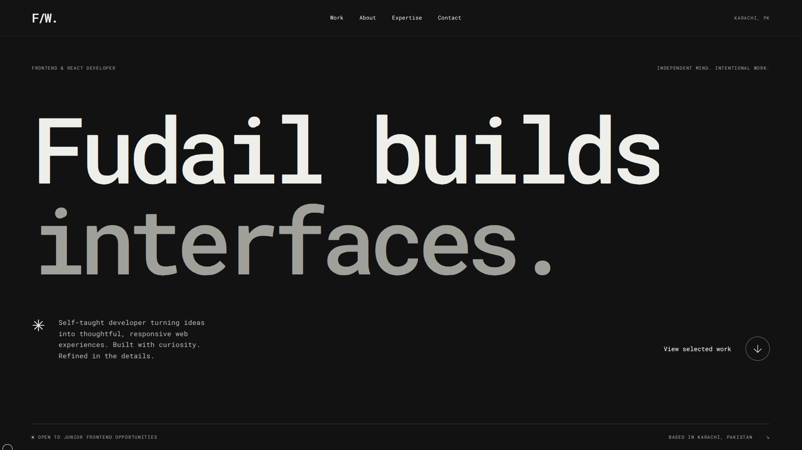

# Fudail Wasif — Frontend & React Developer

An editorial, monochrome portfolio built with React 19, Vite 8, Tailwind CSS v4, GSAP, Motion for React, and Locomotive Scroll 5.0.1. It is a client-only single page with in-document navigation; there is no router or backend.

[View the portfolio](https://fudailwasif.vercel.app/)

## Run locally

Use Node 20.19+ (or a supported newer release) and npm:

```sh
npm ci
npm run dev
```

```sh
npm run lint
npm run build
npm run preview
```




There is no test framework configured. Lint and build are the repository's validation commands.

## Selected Work

Three editorial project rows pair oversized titles with screenshots, project summaries, engineering notes, expandable details, and live/source actions. Motion for React handles row emphasis, image and title hover effects, and video crossfades.

Each project has a compact 1280 × 720 H.264 MP4 preview (each under 1.2 MB) in `public/videos/`: `high-grade-inspection.mp4`, `gitscout.mp4`, and `rick-owens.mp4`. On eligible desktop fine-pointer devices, hovering a row or focusing its image/title link requests muted, looping playback. Videos use `preload="none"`, receive a source only when requested, and play one at a time; playback stops when the row is left or leaves the viewport. Responsive WebP screenshots (640, 960, and 1440px variants) remain visible before playback and serve as fallbacks when video cannot play or previews are disabled. Previews are disabled for reduced motion, limited device resources, and constrained connections.

- [High Grade Inspection](https://highgradeinspection.vercel.app/): visible service information, navigation, responsive presentation, and contact paths. No implementation stack or business outcome is claimed without source evidence.
- [GitScout source](https://github.com/fudailwasif/GitScout): React, Tailwind, Axios, GitHub REST API, parallel requests, request cancellation, and loading/error/missing-data handling. [Live demo](https://gitscout-nu.vercel.app/).
- [Rick Owens recreation source](https://github.com/fudailwasif/RickOwens-Frontend-Recreation): React, routing, shared cart/wishlist state, and browser persistence. An unofficial educational recreation with frontend-only account/checkout screens. [Live demo](https://rick-owens-frontend-recreation.vercel.app/home).

Project content, links, preview paths, and screenshot metadata live in `src/data/projects.js`.

## Motion and scrolling

`src/hooks/usePageMotion.js` uses GSAP, ScrollTrigger, and SplitText for section reveals, split heading entrances, project-row sequences, and a small first-project image transition below 1024px. `src/hooks/useScroll.js` owns anchor navigation, focus, history restoration, and scroll locking. On eligible desktop fine-pointer devices, it creates Locomotive Scroll with smooth wheel scrolling, sends scroll updates to ScrollTrigger, and adds Locomotive's render callback to the GSAP ticker. Touch and reduced-motion layouts use native scrolling.

Motion for React also powers the mobile menu, magnetic links, project interactions, and custom cursor. The cursor uses motion values and springs for position and size, with contextual text, link, project-image (`VIEW`), and email states plus light/dark styling. It is available on fine-pointer layouts from 768px, and yields to the native cursor during text selection and in editable controls.

The type-led intro runs on page load when motion and device resources permit. It releases the scroll lock when its CSS animation ends or its timeout fires. Reduced-motion and limited-resource settings skip the intro; no repeat-visit behavior is implemented.

## Accessibility, performance, and discovery

- Semantic sections, a skip link, one H1, visible focus styles, descriptive image alternatives, labeled links, and native expandable project details support keyboard and assistive-technology use. The mobile menu is a native modal dialog with Escape handling, a Tab loop, focus restoration, and scroll unlocking before navigation.
- Layouts adapt at 1024px and 768px, including the project rows and mobile navigation. Reduced-motion preferences suppress entrance animation and video previews; data-saving, low-resource, or slow-connection signals also limit heavier effects.
- Project screenshots use responsive WebP sources, lazy loading, and async decoding. Videos are requested only on interaction. The locally bundled Latin Roboto Mono variable font uses `font-display: swap`.
- `vite.config.js` inserts a semantic HTML fallback from the same profile and project data, so descriptions, screenshots, and links remain available without JavaScript. It also emits JSON-LD for the person, website, and projects. `index.html` defines canonical, description, robots, Open Graph, and Twitter metadata; `public/robots.txt` references the single-page sitemap.

Core content is in `src/data/profile.js` and `src/data/projects.js`; section components are in `src/components/`. Global typography, layout, breakpoints, and focus styles are in `src/index.css`.
